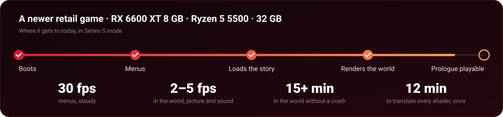
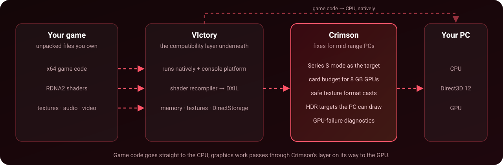

<p align="center">
  
</p>

<p align="center">
  <a href="https://discord.gg/bbdTtcVKnR"></a>
  <a href="https://github.com/Marvisak/VIctory"></a>
  <a href="LICENSE"></a>
  
  
  
  
</p>

<p align="center">
  <b><a href="#status">Status</a></b> ·
  <b><a href="#highlights">Highlights</a></b> ·
  <b><a href="#how-it-works">How it works</a></b> ·
  <b><a href="#quick-start">Quick start</a></b> ·
  <b><a href="#settings">Settings</a></b> ·
  <b><a href="#what-crimson-changes">What Crimson changes</a></b> ·
  <b><a href="#known-issues">Known issues</a></b> ·
  <b><a href="#upstream-and-credits">Credits</a></b> ·
  <b><a href="https://discord.gg/bbdTtcVKnR">Discord</a></b>
</p>

# Crimson

Crimson is a fork of [VIctory](https://github.com/Marvisak/VIctory), an Xbox Series X|S → Windows compatibility layer. VIctory does the hard part: the game's x64 code runs natively, the console platform is reimplemented, and the console's RDNA2 shaders are recompiled to DXIL. Crimson builds on that with one goal: **Series X|S games you own, running at roughly Series S–level performance on comparable PC hardware** – an 8 GB RDNA2 card, a 6-core CPU and 32 GB of RAM.

> [!IMPORTANT]
> Crimson works only on game files you already own. It does not download, decrypt or unpack game packages and contains nothing for circumventing DRM. Like VIctory, the repository holds nothing from any game: no assets, shaders, code or data ([asset policy](docs/asset-policy.md)).

> [!WARNING]
> Crimson is early and experimental. There are no releases yet and nothing is playable yet. Progress is posted as it lands – follow along on [Discord](https://discord.gg/bbdTtcVKnR).

> [!NOTE]
> Crimson was built on [XCL](https://github.com/xcl-dev/xcl) until November 2026. On the test system VIctory got further in a few hours than three days of work on XCL, so Crimson moved. The XCL-based work is kept on the [`xcl-legacy`](https://github.com/WarmMilkCodes/crimson-layer/tree/xcl-legacy) branch.

<p align="center"></p>

## Status

<p align="center">
  
</p>

| Stage | State | Notes |
|---|---|---|
| Boots, menus | ✅ | steady 30 fps |
| Loads the story | ✅ | about 5 minutes on first run |
| Renders the world | ✅ | Series S mode: picture and sound |
| Stays up | ✅ | runs of more than 15 minutes in the world, no crash |
| Prologue playable | 🚧 | 3–5 fps in light scenes, 1.5–3 fps in busy ones; lighting and texture streaming incomplete |
| Playable at 30 fps | ❌ | – |

<sub>Test system: AMD Radeon RX 6600 XT 8 GB · Ryzen 5 5500 · 32 GB DDR4 · Windows 11 23H2 (build 22631).</sub>

## Highlights

<table>
  <tr>
    <td width="33%" valign="top" align="center">
      <br>
      <p align="left"><b>Series S as the target</b> – tuned and tested on the PC hardware closest to a Series S, not a top-end GPU.</p>
    </td>
    <td width="33%" valign="top" align="center">
      <br>
      <p align="left"><b>Built for 8 GB</b> – command memory and texture budgets fit a card a third the size of the one VIctory is tuned on, without the GPU being lost.</p>
    </td>
    <td width="33%" valign="top" align="center">
      <br>
      <p align="left"><b>Format fixes</b> – texture casts and HDR targets that removed the GPU on Windows 11 23H2 with an RDNA2 card are made safely.</p>
    </td>
  </tr>
  <tr>
    <td width="33%" valign="top" align="center">
      <br>
      <p align="left"><b>Measured, not guessed</b> – each change comes from a crash pinned in VIctory's logs, the D3D12 debug layer or Windows' own counters.</p>
    </td>
    <td width="33%" valign="top" align="center">
      <br>
      <p align="left"><b>Tested on real mid-range hardware</b> – every change is run on an RX 6600 XT with 32 GB of RAM before it lands.</p>
    </td>
    <td width="33%" valign="top" align="center">
      <br>
      <p align="left"><b>Tracks upstream VIctory</b> – kept in sync with VIctory's main branch; general fixes are offered back upstream.</p>
    </td>
  </tr>
</table>

## How it works

<p align="center">
  
</p>

Crimson is VIctory plus a set of changes for mid-range hardware. Everything VIctory documents still applies; see [docs/architecture.md](docs/architecture.md) and [VIctory's README](https://github.com/Marvisak/VIctory#readme) for the design.

<p align="center"></p>

## Quick start

**Requirements:** Windows 10 / 11 x64, a CPU with AVX2, a Direct3D 12 GPU with Shader Model 6.6 and mesh shaders, Rust via [rustup](https://rustup.rs) (the toolchain is pinned in `rust-toolchain.toml` and fetched on first build), and the MSVC C++ build tools ("Desktop development with C++"). For Series S mode, the [AMD FidelityFX SDK](https://github.com/GPUOpen-LibrariesAndSDKs/FidelityFX-SDK) (a release with `amd_fidelityfx_upscaler_dx12.dll`).

1. **Build.** Keep the build folder short: a deep path breaks one dependency's build.

   ```powershell
   git clone https://github.com/WarmMilkCodes/crimson-layer
   cd crimson-layer
   $env:CARGO_TARGET_DIR = 'C:\vt'
   cargo build --release -p victory
   ```

2. **Point it at your game.** Copy `victory.example.toml` to `victory.toml` and set the paths – all outside the repository:

   ```toml
   [paths]
   game_dir = 'D:\Game'
   cache_dir = 'D:\crimson-data\cache'
   data_dir = 'D:\crimson-data\data'
   test_titles = []
   ```

3. **Translate the shaders** (first time only; about 12 minutes on a Ryzen 5 5500):

   ```powershell
   C:\vt\release\crimson.exe translate --cache D:\Game\shaders.rpf D:\Game\<the game's exe> D:\Game\XboxBvhBuilder.dll D:\Game\amd_fidelityfx_upscaler_xbox.dll
   ```

4. **Run in Series S mode:**

   ```powershell
   $env:VICTORY_FIDELITYFX_DIR = 'D:\fidelityfx\FidelityFX-SDK-2.4.0\Kits\FidelityFX\signedbin'
   C:\vt\release\crimson.exe run D:\Game\<the game's exe> --execute --console series-s
   ```

   Press A (or Enter) on each first-boot screen and on the account picker. The game folder is never modified. The window's title shows the time since the window opened, the time since the world started, the frame rate, the time per frame and the draws per frame.

## Settings

For an 8 GB RDNA2 card:

| Variable | Recommended | What it does |
|---|---|---|
| `VICTORY_FIDELITYFX_DIR` | the SDK's `signedbin` folder | runs AMD's PC upscaler in Series S mode (the console one does not work yet) |
| `VICTORY_CARD_MARKS` | unset | gives textures up past the first share of the card's budget, down to the second (default `90,85`); lower values free memory but make textures load again |
| `VICTORY_BVH_BUILDER` | unset | `1` runs the console's ray-tracing structure builder (off by default: costly, and unsafe while any of its stages is missing) |
| `VICTORY_SHADER_OPT` | unset | `0` turns off the clean-up passes over translated shaders (part of the shader cache's key: translate again after changing it) |
| `VICTORY_FORMAT_LISTS` | unset | `1` forces texture format lists on, `0` off (default: on from Windows 11 24H2) |
| `VICTORY_D3D12_DEBUG` | unset | `1` with a `--features diagnostics` build: the D3D12 debug layer names invalid calls |

<details>
<summary><b>Windows settings that matter</b></summary>

- **Page file:** a world run commits about 35 GB. With 32 GB of RAM, set a fixed page file of about 48 GB on a roomy drive (System Properties → Advanced → Performance → Virtual memory).
- **Close other apps** before a run – free RAM goes fast once the world loads.

</details>

<p align="center"></p>

## What Crimson changes

<details>
<summary><b>Stability</b> – GPU losses and game crashes</summary>

| Change | Why |
|---|---|
| **State preludes from a shared pool** | VIctory gave every command list a second command allocator. On an AMD driver each one that has recorded keeps a megabyte of command memory in a 2 GB pool; after a few minutes in the world the pool was full and Windows removed the device ("failed to page in required resource" in a GPU trace). Preludes are now taken from a pool as large as one submission needs. |
| **Ray-tracing structure builder off** (`VICTORY_BVH_BUILDER`) | The builder's stages feed each other through memory. With a stage missing, the others compute where to write from garbage and write into the game's own objects; the game then crashed on pointers made of empty bounding boxes. Off by default; it also frees CPU time each frame. |
| **No texture format lists before Windows 11 24H2** | On build 22631 with an RX 6600 XT, the system reports format-list casting, accepts the lists, then removes the device when a view casts across format families. Without lists, VIctory makes a texture per format, bridged by a copy. `VICTORY_FORMAT_LISTS` overrides. |
| **R9G9B9E5 views of other formats left null without lists** | A safety net for the cast above; where lists are used (24H2 on), the views are made. |
| **R9G9B9E5 render targets made as R11G11B10_FLOAT** | The PC can't draw into the packed HDR format the console uses for its 1080p picture in Series S mode, so the texture was never created and the upscaler had no target. Same size per pixel, three float channels. |
| **Crash reports name recent writes** | A game crash's report says whether its registers point into memory the layer wrote shortly before. |

</details>

<details>
<summary><b>Rendering</b></summary>

| Change | Why |
|---|---|
| **A host texture per format family without lists** | The game packs light into integer textures and reads them back as packed HDR. Without format lists, the two kept replacing each other as the memory's texture and the HDR one was refused, so the sky and bounced light came out black. Each now keeps its own texture, bridged by a copy. |

</details>

<details>
<summary><b>Performance and memory</b></summary>

| Change | Why |
|---|---|
| **Clean-up passes over translated shaders** (`VICTORY_SHADER_OPT`) | Dead code, constant folding, repeated reads merged, from [VIctory-7900XTX](https://github.com/avatarmanz/VIctory-7900XTX). No measurable GPU gain on the test card (the driver's compiler does much of it), kept because it makes smaller shaders. |
| **Adjustable card budget marks** (`VICTORY_CARD_MARKS`) | The share of the card at which textures are given up. Low marks were tried on 8 GB and made textures load again in bursts; the default is used now. |
| **World timer** | The window's title also shows the time since the world started. |

</details>

<details>
<summary><b>Planned</b></summary>

- Light the world fully: the sky and indirect light are still dark in many scenes.
- Faster texture streaming: detailed models and textures arrive late, so stand-ins show for a while.
- Frame rate: about half of each frame is CPU work preparing and copying game memory for the GPU, the other half GPU time.
- Make Series S mode and the PC upscaler the defaults on 8 GB cards.

</details>

## Known issues

- **2–5 fps in the world**; 30 fps is not in reach on an RX 6600 XT yet.
- **Lighting:** the sky and indirect light are dark in many scenes, and ray-traced lighting is off.
- **Streaming:** detailed models and textures arrive late; low-detail stand-ins show first.
- **Series S mode needs the PC upscaler** (`VICTORY_FIDELITYFX_DIR`); with the console's own upscaler the GPU is lost when the world starts.
- **Series X mode on 8 GB cards** loses the GPU within seconds of the world starting.
- **First launch is long**: translate the shaders first; the driver also builds pipelines during the first runs.

## Community

Questions, test results and progress updates: **[join the Crimson Discord](https://discord.gg/bbdTtcVKnR)**. Bugs and code changes go in this repository's issues and pull requests.

## Upstream and credits

Crimson exists because of [VIctory](https://github.com/Marvisak/VIctory) by Marvisak and its contributors. It follows VIctory's main branch; fixes that help everyone are offered back upstream, and problems that also happen on plain VIctory belong in [VIctory's issues](https://github.com/Marvisak/VIctory/issues). The forks around VIctory were useful as references while testing. The shader clean-up passes (`crates/victory-shader/src/emit/bitcode/opt.rs`) come from [VIctory-7900XTX](https://github.com/avatarmanz/VIctory-7900XTX), after [fxceless/victory-fork](https://github.com/fxceless/victory-fork), under the same license. What Crimson changed, and when, is listed in [NOTICE.md](NOTICE.md).

Earlier versions of Crimson were built on [XCL](https://github.com/xcl-dev/xcl); thanks to its contributors too.

## License

GPL-3.0-or-later, the same as VIctory. See [LICENSE](LICENSE) and [NOTICE.md](NOTICE.md).
