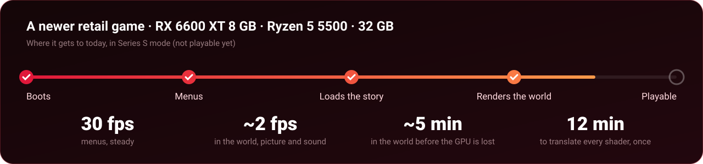

<p align="center">
<<<<<<< HEAD
  
</p>

<p align="center">
  <a href="https://discord.gg/bbdTtcVKnR"></a>
  <a href="https://github.com/xcl-dev/xcl"></a>
  <a href="LICENSE"></a>
  
  
  
  
</p>
=======
  
</p>

<p align="center">
  <a href="https://discord.gg/xcl"></a>
  <a href="https://github.com/xcl-dev/xcl/actions/workflows/ci.yml"></a>
  <a href="LICENSE"></a>
  
  
  
</p>

<p align="center">
  <b><a href="#games">Games</a></b> ·
  <b><a href="#highlights">Highlights</a></b> ·
  <b><a href="#how-it-works">How it works</a></b> ·
  <b><a href="#quick-start">Quick start</a></b> ·
  <b><a href="#what-works">What works</a></b> ·
  <b><a href="#controls">Controls</a></b> ·
  <b><a href="#building-and-usage">Building and usage</a></b> ·
  <b><a href="#tests">Tests</a></b> ·
  <b><a href="#contributing">Contributing</a></b>
</p>

# XCL – Xbox Series X|S → Windows compatibility layer
>>>>>>> origin/main

<p align="center">
  <b><a href="#status">Status</a></b> ·
  <b><a href="#highlights">Highlights</a></b> ·
  <b><a href="#how-it-works">How it works</a></b> ·
  <b><a href="#quick-start">Quick start</a></b> ·
  <b><a href="#recommended-settings">Settings</a></b> ·
  <b><a href="#what-crimson-changes">What Crimson changes</a></b> ·
  <b><a href="#known-issues">Known issues</a></b> ·
  <b><a href="#upstream">Upstream</a></b> ·
  <b><a href="https://discord.gg/bbdTtcVKnR">Discord</a></b>
</p>

<<<<<<< HEAD
# Crimson
=======
> [!IMPORTANT]
> XCL works only on unpacked game files you already own. It does not download, decrypt or unpack game packages (XVC / MSIXVC) and contains nothing for circumventing DRM. The repository holds no code, headers or binaries from the console SDK, no keys and no game data; the Windows components XCL relies on (XGameRuntime, XAudio2, D3D12, DXC) come from your own system or the public Windows SDK and are not distributed with XCL.

<p align="center"></p>
>>>>>>> origin/main

Crimson is a performance-focused fork of [XCL](https://github.com/xcl-dev/xcl), the Xbox Series X|S → Windows compatibility layer. XCL does the hard part: the game's x64 code runs natively, console system libraries are reimplemented, and the console's RDNA2 shaders are recompiled to DXIL. Crimson builds on that with one goal: **Series X|S games you own, running at roughly Series S–level performance on comparable PC hardware** – an 8 GB RDNA2 card, a 6-core CPU and 32 GB of RAM.

<<<<<<< HEAD
> [!IMPORTANT]
> Crimson works only on unpacked game files you already own. Like XCL, it does not download, decrypt or unpack game packages and contains nothing for circumventing DRM. The repository holds no console SDK code, keys or game data.

> [!WARNING]
> Crimson is early and experimental. There are no releases yet, nothing is playable yet, and first launches are long. Progress is posted as it lands – follow along on [Discord](https://discord.gg/bbdTtcVKnR).

<p align="center"></p>

## Status

<p align="center">
  
</p>

| Stage | State | Notes |
|---|---|---|
| Boots and plays its intro | ✅ | steady 30 fps |
| Menus and account selection | ✅ | keyboard works as a gamepad |
| Loads into the story | ✅ | audio and music play |
| Renders the 3D world | 🚧 | black screen; the GPU is lost a few minutes in (being worked on) |
| Playable | ❌ | – |

<sub>Test system: AMD Radeon RX 6600 XT 8 GB · Ryzen 5 5500 · 32 GB DDR4 · Windows 11.</sub>
=======
<p align="center">
  
</p>

| Game | State | What works | Limits |
|---|---|---|---|
| **Minecraft Preview**<br><sub>`Microsoft.MinecraftBeta` 1.18.3064.0</sub> | ✅&nbsp;playable | fully playable | – |
| **Unicorn Overlord**<br><sub>`SEGAofAmericaInc.Pa253b0c1Y` 1.0.0.6</sub> | ✅&nbsp;playable | fully playable | – |
| **Fortnite**<br><sub>`436609B6.FortniteClient` 2.0.1461.7919</sub> | ✅&nbsp;works | works fully, as far as the game allows without its online services | the game itself is online-only (multiplayer servers) |
| **XDefiant**<br><sub>`Ubisoft.XDefiant-Game` 1.0.0.186</sub> | ✅&nbsp;works | works fully, as far as the game allows without its servers | the game's own servers have been shut down |
| **A newer retail game** | 🚧&nbsp;**≈&nbsp;60&nbsp;%**<br><sub>estimate</sub> | starts in ~4 s, runs at a steady 30 fps without a crash, shows its menus and goes on past the first one to its settings; fits a 32 GB machine (~15 GB committed in the menus). With the NVIDIA integration branch ([#2057](https://github.com/xcl-dev/xcl/pull/2057)) it goes on into its 3D world: **~5 fps there** on an RTX 5090 (14 fps on average over a whole 5-minute run, its menus and loading included) | not playable yet: the picture of the world is incomplete (its minimap and other mesh pipelines are refused), and it does not keep running there for long |
>>>>>>> origin/main

## Highlights

<table>
  <tr>
    <td width="33%" valign="top" align="center">
<<<<<<< HEAD
      <br>
      <p align="left"><b>Series S as the target</b> – tuned and tested on the PC hardware closest to a Series S, not a top-end GPU.</p>
    </td>
    <td width="33%" valign="top" align="center">
      <br>
      <p align="left"><b>Memory gate</b> – shader compiles wait for free RAM instead of piling on, so a precompile or a game doesn't crash because your browser is open.</p>
    </td>
    <td width="33%" valign="top" align="center">
      <br>
      <p align="left"><b>Bounded pipeline waits</b> – the game never waits long enough on a compiling shader to trip its own hang watchdog.</p>
=======
      <br>
      <p align="left"><b>No CPU emulation</b> – the game's x64 code runs natively, in the spirit of Wine / Proton.</p>
    </td>
    <td width="33%" valign="top" align="center">
      <br>
      <p align="left"><b>100 % of a retail game's shaders translate</b> – all 26 698 RDNA2 programs (26 503 records) of its shader pack become HLSL; random samples compile to DXIL with 0 errors.</p>
    </td>
    <td width="33%" valign="top" align="center">
      <br>
      <p align="left"><b>The game's own console DLLs run on the PC</b> – its Bink 2 video codec decodes the game's movies, its ray-tracing BVH builder builds acceleration structures on a PC GPU, the AMD FSR 4 console upscaler runs a whole frame on a PC GPU, the GDK HTTP library initialises.</p>
>>>>>>> origin/main
    </td>
  </tr>
  <tr>
    <td width="33%" valign="top" align="center">
<<<<<<< HEAD
      <br>
      <p align="left"><b>Ray-tracing shader routing</b> – ray-tracing shaders that hung AMD's driver are built through a path the driver survives.</p>
    </td>
    <td width="33%" valign="top" align="center">
      <br>
      <p align="left"><b>Driver-failure diagnostics</b> – pipeline tracing, skip and filter switches that pin a GPU hang on one shader in seconds instead of hours.</p>
    </td>
    <td width="33%" valign="top" align="center">
      <br>
      <p align="left"><b>Tracks upstream XCL</b> – synced with XCL's main branch; general fixes are offered back upstream.</p>
    </td>
  </tr>
</table>
=======
      <br>
      <p align="left"><b>Console textures decode exactly</b> – the GFX10 tiling and mip layout reproduce 909 of 912 textures of the game's texture archive byte for byte, its volume textures included.</p>
    </td>
    <td width="33%" valign="top" align="center">
      <br>
      <p align="left"><b>The console's storage queues</b> – DirectStorage with file and memory sources, zlib and BCPack (BC1, BC3 – BC7).</p>
    </td>
    <td width="33%" valign="top" align="center">
      <br>
      <p align="left"><b>370+ automated tests</b>, including GPU tests that compare translated shaders against expected results instruction by instruction.</p>
    </td>
  </tr>
</table>

## How it works

<p align="center">
  
</p>

The game's code runs on the CPU as it is; each call into a console library lands in XCL's own
implementation of it, and each shader is translated once and cached. The details:
[`docs/specs/2026-11-20-xcl-design.md`](docs/specs/2026-11-20-xcl-design.md), status and
measurements: [`HANDOFF.md`](HANDOFF.md).

## Quick start

1. **Build** – Windows 10 / 11 x64, Rust and the Windows SDK ([all requirements](#building-and-usage)):

   ```powershell
   cargo build --release --workspace
   ```

2. **Look at your game** – its unpacked files, the folder that holds `MicrosoftGame.config`:

   ```powershell
   target\release\xcl.exe inspect D:\Game\game.exe
   ```

3. **Run it** – or open `xcl.exe` from Explorer and choose the game:

   ```powershell
   target\release\xcl.exe run D:\Game
   ```

A gamepad is recommended ([Controls](#controls)). The game folder is never modified.

<p align="center"></p>
>>>>>>> origin/main

## How it works

<p align="center">
  
</p>

<<<<<<< HEAD
Crimson is XCL plus a set of changes focused on mid-range hardware. Everything XCL documents still applies; see [XCL's README](https://github.com/xcl-dev/xcl#readme) for the design and the full feature list.
=======
<details>
<summary><b>Running the game's code</b> – PE loader, kernelx, Memory, File system, DirectStorage</summary>
>>>>>>> origin/main

<p align="center"></p>

<<<<<<< HEAD
## Quick start

**Requirements:** Windows 10 / 11 x64, Rust (`stable-x86_64-pc-windows-msvc`), the Windows SDK (DXC 1.8 or newer), a D3D12 GPU with Shader Model 6.6 and mesh shaders. Same as [XCL](https://github.com/xcl-dev/xcl#building-and-usage).

1. **Build**
=======
</details>

<details>
<summary><b>System services</b> – XGameRuntime, Input, Audio</summary>

| Feature | State | What it does | Verified by |
|---|---|---|---|
| **XGameRuntime** | ✅ | the GDK thunk protocol real titles use, laid out from a table of all 396 GDK runtime functions; offline XUser, XGameSave, persistent local storage, XPackage, XGame (title id), XSystem – the title sees an Xbox Series X / S; task queues, async, networking and dialogs through the PC's XGameRuntime | the game's libHttpClient initialises; users, saves and storage through the real call path; slot layout cross-checked against the game's own thunks |
| **Input** | ✅ | GameInput: one gamepad – the PC's XInput controller or a PlayStation controller, and keyboard and mouse as a gamepad (see [Controls](#controls)) | unit tests; an Xbox controller in Minecraft; a DualShock 4 (USB) |
| **Audio** | ✅ | XAudio2 → system XAudio2.9 (PCM / float voices; Opus 0x704F decoded via `MSOpusDecoder.dll`; XMA1 / XMA2 decoded in pure Rust) | unit + end-to-end tests |

</details>

<details>
<summary><b>Graphics</b> – Shader recompiler, Pipelines, D3D12.X compute, D3D12.X graphics, Textures, Ray tracing, Upscaling</summary>
>>>>>>> origin/main

   ```powershell
   git clone https://github.com/WarmMilkCodes/crimson-layer
   cd crimson-layer
   cargo build --release --workspace
   ```

<<<<<<< HEAD
2. **Precompile the shaders** (first time only; can take hours for a large game, and everything built is cached)
=======
Far-jump address calculations are resolved to fixed targets only when branches enter at the start of the calculation.
An entry partway through it keeps the jump indirect and subject to the recompiler's existing indirect-branch limits.

</details>

<details>
<summary><b>Media and tools</b> – Video, Tools</summary>
>>>>>>> origin/main

   ```powershell
   .\target\release\xcl.exe shaders "D:\Game\shaders.rpf" --precompile --only cs --pipelines
   ```

<<<<<<< HEAD
3. **Run the game** – the folder that holds `MicrosoftGame.config`:
=======
</details>

## Controls
>>>>>>> origin/main

   ```powershell
   .\target\release\xcl.exe run "D:\Game"
   ```

<<<<<<< HEAD
The game folder is never modified. A gamepad is recommended; keyboard and mouse also work as a gamepad.
=======
- **Gamepad:** any controller Windows sees through XInput (Xbox controllers, wired or wireless) is the
  game's gamepad – buttons, sticks, triggers and rumble. It can be plugged in or out while the game runs.
- **PlayStation controllers** (DualShock 4 wired or over Bluetooth, DualSense wired) are the gamepad
  when no XInput controller is connected – buttons, sticks and triggers, no rumble or light bar.
  `XCL_PLAYSTATION_PAD=0` turns this off.
- **Keyboard and mouse** work too, as a gamepad: WASD the left stick, the mouse the right stick, mouse
  buttons the triggers, the wheel the bumpers, Enter / Space A, Escape / Backspace B, arrows the D-pad,
  E / Q Y / X, Shift / Ctrl the stick clicks, Tab View, P Menu. `keyboard_mouse` and `mouse_sensitivity` in
  the game's `xcl.toml` turn it off or change the mouse speed. A gamepad and the keyboard / mouse can be
  used together.
>>>>>>> origin/main

## Recommended settings

<<<<<<< HEAD
For an 8 GB RDNA2 card. Set once; they apply to new PowerShell windows:

```powershell
setx XCL_PSO_WAIT_MS 4000      # bound how long the game waits for a pipeline still compiling
setx XCL_PSO_PRELOAD 0         # the used-pipeline preload leaks memory on this setup
setx XCL_DIRECT_DXIL 1         # faster compute shader translation (ray tracing goes the safe way)
setx XCL_HEAP_WINDOWS 1        # smaller, faster shaders
setx XCL_NETWORK 0             # offline, including crash-report uploads
setx XCL_WINDOW_POS center     # open the game window on the main monitor
```

Optional: put the shader caches on a roomy drive with `setx XCL_DATA_ROOT D:\xcl-data`.

<details>
<summary><b>Crimson's own switches</b></summary>
=======
Windows 10/11 x64, Rust (`stable-x86_64-pc-windows-msvc`), the Windows SDK (DXC: `dxcompiler.dll`
and `dxil.dll`, looked up in `Windows Kits\10\bin\<version>\x64`, next to `xcl.exe` or in
`%XCL_DXC_DIR%`), a D3D12 GPU with Shader Model 6.6 and mesh shaders, and the system XGameRuntime
(`System32\xgameruntime.dll`, part of Windows / Gaming Services). On **Windows 10** (22H2
KB5029331+), inbox `D3D12Core.dll` stops at SM 6.5; place the Microsoft D3D12 Agility SDK
(`D3D12Core.dll`, plus `d3d12SDKLayers.dll` if using `XCL_D3D12_DEBUG=1`) in a `D3D12\` folder
next to `xcl.exe`, directly next to `xcl.exe`, in `%LOCALAPPDATA%\XCL\D3D12\`, or point `%XCL_D3D12_DIR%` at it
(for `cargo test`, use `%LOCALAPPDATA%\XCL\D3D12\` or `%XCL_D3D12_DIR%`).

- **DXC:** 1.8 or newer is recommended, from the
  [DirectXShaderCompiler releases](https://github.com/microsoft/DirectXShaderCompiler/releases): unpack one
  and point `XCL_DXC_DIR` at its `bin\x64`. A Windows SDK may hold an older one (the same `10.0.26100.0`
  folder has DXC 1.7.2308 or 1.8.2502, depending on the SDK's revision). DXC 1.7's DXIL was 2–2.7 times the
  size of 1.9's for translated compute programs and took an NVIDIA driver 1.4–2.2 times as long to build
  pipelines from ([#156](https://github.com/ivall/xcl/issues/156)). `xcl run` prints the DXC it loaded, and
  `report.json` has it under `dxc`.
- **GPU:** developed on AMD RDNA4. The console's geometry and NGG programs run as a compute pass plus a
  mesh pass, so a GPU without mesh shaders draws none of them. On GPUs with 32-lane waves only
  (NVIDIA) console wave64 compute, geometry and mesh programs run as two 32-lane halves that exchange
  masks and lane values ([`docs/wave64-on-wave32.md`](docs/wave64-on-wave32.md)) – slower than
  64-lane waves, most for groups of several waves; wave64 vertex and pixel shaders that read lanes 32–63
  can still differ there. With `XCL_DIRECT_DXIL=1` and `XCL_PER_LANE=1`, compute groups
  made up of complete native waves can use the per-lane form for branches on whole-wave masks.
  Test results on other GPUs: [#42](https://github.com/ivall/xcl/issues/42).

```powershell
cargo build --release --workspace          # target\release\xcl.exe

xcl inspect D:\Game\game.exe               # the game's imports and what XCL has for them
xcl run D:\Game [-- game arguments]        # run
xcl disasm <shader.bin> [--hex]            # RDNA2 disassembler (console containers too)
xcl shaders D:\data\shaders.rpf --top 50   # pack statistics; --recomp / --compile N
xcl shaders D:\data\shaders.rpf --precompile --only cs --pipelines   # build compute pipelines and save driver blobs for the next run
xcl shaders D:\data\shaders.rpf --precompile --only cs --pipelines --used-only   # only the compute pipelines an earlier run of the title used
xcl shaders D:\data\shaders.rpf --export-hlsl out --record-hash HEX  # exact compute HLSL for investigation
xcl shaders D:\data\shaders.rpf --measure-pso HEX --repeat 3         # cold driver PSO timing (cache disabled)
xcl rpf D:\data\shaders.rpf --extract NAME --out folder
```

<details>
<summary><b>Switches, caches, logs and the files XCL writes</b></summary>

- **`--pipelines` size cap**: a compute program whose DXIL is over 8 MiB and that has no saved
  blob is left to the runtime instead of being compiled in the pass — those compiles take tens
  of minutes and gigabytes and stopped the pass on the biggest programs. `XCL_PIPELINE_MAX_KB`
  sets the cap in KiB (0 turns it off).
- **Without a command line** (xcl.exe opened from Explorer) XCL shows a small menu: *Choose a
  game…* (pick its exe or `MicrosoftGame.config`) or *Run again* (the last one). On an error the
  window stays open until Enter.
- XCL works on **unpacked** game files you own; it contains nothing for decrypting or
  circumventing DRM.
- **The game folder is never modified** – writes go to the overlay.
- Translated shaders are reused across XCL rebuilds when the translator sources and DXC
  toolchain are unchanged; `XCL_TRANSLATED_CACHE=0` disables that disk cache.
- Huge pipelines (translated DXIL of `XCL_HUGE_PSO_BYTES` or more, default 262144) built on the
  background `xcl-pso*` workers take turns in the driver's compiler: `XCL_HUGE_PSO_CONCURRENCY`
  at once (default 1, maximum 64). Pipelines of 4 MiB or more use a separate one-wide lane so
  they cannot occupy the ordinary huge-pipeline slot; one of them can therefore run next to the
  ordinary ones, and each gated compile starts only with 3 GB of commit free. Smaller pipelines
  and those a game thread waits for never wait. `xcl.log` shows each huge one as a numbered
  `driver compile start #K` / `driver compile finish #K: … PSO, N B DXIL, M ms` pair (compute
  ones with `record HASH`, the console record's hash that `--measure-pso` and
  `--export-hlsl --record-hash` take), with whether it was gated and how long it waited;
  `XCL_PSO_TRACE=1` logs every driver compile. A huge compute program the driver refuses is
  logged with the driver's verdict (`the driver refused the compute PSO of record HASH … with
  0x…`): its dispatches are skipped.
- With `XCL_DRED=1`, a D3D12 device removal logs GPU breadcrumbs in `xcl.log`.
  XCL examines up to 4,096 command lists and reports up to 64 unfinished lists, starting with
  those on which the GPU completed at least one operation.
- `XCL_DSTORAGE_PARALLEL_DECOMPRESS=1` enables parallel CPU decompression for file-backed zlib
  requests with virtual destinations. Defaults: four workers and a shared 32 MiB staging budget
  (`XCL_DSTORAGE_WORKERS`, `XCL_DSTORAGE_MEMORY_BUDGET_MIB`). Requests retire in queue order.
- Every run writes `report.json` (called stubs, unknown D3D12.X slots and interfaces, XGameRuntime
  classes asked for, shader statistics, audio formats, crash).
  `d3d12.presents` counts presentations, not visible content. With `XCL_FRAME_DUMP=N` (`N > 1`),
  the existing optional frame dumps also set `d3d12.last_frame_dump`: the latest sampled frame's
  zero-based index, source dimensions, DXGI format, sample step, sample count and `non_dark_samples`
  (decoded 8-bit R+G+B > 30). The field is `null` until a frame is sampled; `non_dark_samples` is
  `null` if its format cannot be decoded. Intermediate render-target dumps do not update it.
  Sampling uses every fourth pixel in each direction (`XCL_FRAME_DUMP_FULL=1`: every pixel).
  A coarse sample can miss detail; a non-dark sample does not establish correct rendering or gameplay.
- Title data: `%LOCALAPPDATA%\XCL\<title>\` (`%XCL_DATA_ROOT%`): `xcl.toml`, `overlay\`, `saves\`,
  `pls\` (the title's `S:\`), `temp\` (`T:\`), `cache\`, `logs\xcl.log`, `logs\report.json` (the
  previous run's: `xcl.prev.log`, `report.prev.json`).

</details>

## Tests
>>>>>>> origin/main

| Variable | Default | What it does |
|---|---|---|
| `XCL_MEM_RESERVE_MB` | `6144` | RAM the memory gate keeps free for everything else |
| `XCL_MEM_BIG_KB` | `32` | shader size counted as "big" (needs extra free RAM to start) |
| `XCL_MEM_GATE` | on | `0` turns the memory gate off |
| `XCL_PSO_WAIT_COOLDOWN` | on | `0` turns off the short-wait cooldown after a late pipeline |
| `XCL_DIRECT_DXIL_BVH` | off | `1` sends ray-tracing shaders through the direct translator anyway |
| `XCL_PIPELINE_TRACE` | off | precompile: name each pipeline before the driver gets it |
| `XCL_PIPELINE_SKIP` | – | precompile: skip pipelines whose name contains any of these (comma-separated) |
| `XCL_PIPELINE_ONLY` | – | precompile: build only pipelines whose name contains any of these |
| `XCL_DRED` | off | `breadcrumbs` or `pagefault`: D3D12 crash diagnostics |

</details>

<<<<<<< HEAD
<p align="center"></p>

## What Crimson changes

<details>
<summary><b>Stability</b> – hangs, watchdogs, out-of-memory</summary>

| Change | Why |
|---|---|
| **Bounded pipeline waits with a cooldown** | Back-to-back multi-second waits for compiling pipelines tripped the game's own hang watchdog. After any late pipeline, waits are cut short for a while. |
| **Memory gate** | Several huge shaders compiling at once, plus a browser, ran a 32 GB machine out of memory. Compiles now start only when there's room, and the precompile runs at below-normal priority so the desktop stays responsive. |
| **Ray-tracing shaders through the HLSL path** | The direct DXIL translator's form of a retail game's ray-tracing shaders hung AMD's driver on load (reproducible in seconds). The HLSL path's form of the same shaders builds fine. |

</details>

<details>
<summary><b>Diagnostics</b> – finding what breaks the driver</summary>

| Change | Why |
|---|---|
| **Refusal details** | A refused pipeline now reports the error, the device state and free memory, instead of a bare count. |
| **Pipeline trace / skip / only** | Single-threaded tracing names the pipeline that takes the GPU down; skip and only lists confirm it in a one-minute test. |
| **DRED modes** | Breadcrumbs and page-fault reporting can be switched on separately. |

</details>

<details>
<summary><b>Planned</b></summary>

- Make passes that are skipped while a pipeline compiles harmless, so they can't hang the GPU.
- Compose the console's two display planes, so Series S mode shows its menus.
- Default to Series S settings on 8 GB cards.
- Track down in-game memory growth.
- Ship the recommended settings as defaults.

</details>

## Known issues

- **The 3D world doesn't render yet**, and the GPU is lost a few minutes after the story starts.
- **Series S mode** (`device_type = "lockhart"` in the game's `xcl.toml`) shows a black screen after the intro video – the menus are drawn but not shown yet.
- **First launch is long.** Precompile the shaders first.
- **PCIe power saving** made AMD's driver lose the device during long compiles on the test system. If you see `DEVICE_HUNG` / `0x887A0006` while precompiling:

  ```powershell
  powercfg /setacvalueindex SCHEME_CURRENT SUB_PCIEXPRESS ASPM 0
  powercfg /setactive SCHEME_CURRENT
  ```

## Community

Questions, test results and progress updates: **[join the Crimson Discord](https://discord.gg/bbdTtcVKnR)**. Bugs and code changes go in this repository's issues and pull requests.

## Upstream

Crimson exists because of [XCL](https://github.com/xcl-dev/xcl) and its contributors. It stays in sync with XCL's main branch, and fixes that help everyone are offered back upstream. Problems that also happen on plain XCL belong in [XCL's issues](https://github.com/xcl-dev/xcl/issues); Crimson-specific ones belong here.

## License

GPL-2.0-only, the same as XCL. See [LICENSE](LICENSE) and [THIRD_PARTY.md](THIRD_PARTY.md).
=======
## Contributing

Help is welcome – [`CONTRIBUTING.md`](CONTRIBUTING.md) has what a pull request needs, in short: small,
one problem, tested. Test results on your GPU go to [#42](https://github.com/xcl-dev/xcl/issues/42),
questions and talk to the [Discord server](https://discord.gg/xcl).

<p align="center"></p>

## Licenses

**GPL-2.0-only** (`LICENSE`); third-party sources: `THIRD_PARTY.md` (including AMD's
machine-readable ISA, AMD addrlib swizzle patterns, LLVM disassembler tests, AnyPS5,
libHttpClient headers). WinDurango serves only as a reference – no code is ported from it. The
repository contains no headers or binaries from the console SDK.

The artwork in `assets/readme` is drawn for this repository and under its license. XCL is an independent
project: it is not affiliated with, endorsed or sponsored by the owners of the trademarks named here,
which are named only to say what XCL runs and what it runs on.
>>>>>>> origin/main
